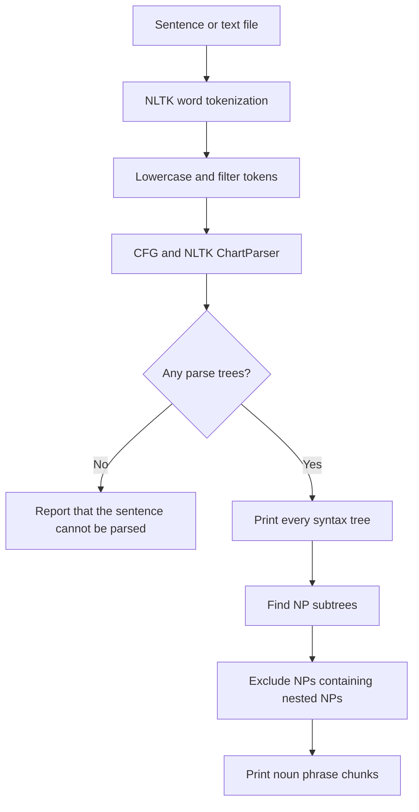

# Parser — Natural Language Parsing with Context-Free Grammars

**Harvard CS50's Introduction to Artificial Intelligence with Python · Project 6a · Natural Language Processing**

A Python natural-language parser that uses a **context-free grammar (CFG)** to build sentence syntax trees and extract **minimal noun phrase chunks** from short English sentences. The implementation uses **NLTK** for tokenization, grammar representation, and chart parsing.

> **Academic context:** Developed as part of Harvard CS50AI. This repository's documentation explains the methods and observed behavior; the original assignment and starter materials belong to their respective authors. See [CS50AI Parser](https://cs50.harvard.edu/ai/projects/6/parser/) and the [verified CS50AI completion certificate](https://cs50.harvard.edu/certificates/4d1848b5-b7cc-4b37-8155-819e19e6054d).

## Project Overview

Parsing is the process of assigning a grammatical structure to a sequence of words. Rather than treating a sentence as an unordered list of words, this project identifies how **noun phrases (NP)**, **verb phrases (VP)**, and **prepositional phrases (PP)** fit together.

The program:

1. Reads a sentence typed interactively or loaded from a text file.
2. Tokenizes the input, lowercases words, and discards tokens with no alphabetic characters.
3. Applies an NLTK context-free grammar and constructs every syntax tree recognized by the grammar.
4. Prints each parse tree and extracts the **smallest NP subtrees**, excluding noun phrases that contain another NP.

### Example

Input:

```text
Holmes sat in the red armchair and he chuckled.
```

Representative noun phrase chunks from a valid parse:

```text
holmes
the red armchair
he
```

The grammar can produce **more than one valid parse tree** for some inputs. When this occurs, the program displays each tree and the chunks extracted from that tree.

## Technical Foundations

### 1. Tokenization and normalization

NLTK's `word_tokenize` divides input text into tokens. The preprocessing step converts tokens to lowercase and retains only those containing at least one alphabetic character. This removes standalone punctuation and numeric-only tokens while preserving the original token order.

### 2. Context-free grammar

The grammar represents sentence structure using symbolic categories:

| Symbol | Meaning | Illustration |
| --- | --- | --- |
| `S` | Sentence | `Holmes sat.` |
| `NP` | Noun phrase | `the red armchair` |
| `VP` | Verb phrase | `sat in the armchair` |
| `PP` | Prepositional phrase | `in the armchair` |
| `Nom` | Nominal sequence | `red armchair` |
| `Det` | Determiner | `the`, `my`, `an` |
| `Adj` | Adjective | `little`, `red`, `moist` |
| `N` | Noun | `holmes`, `pipe`, `door` |
| `V` | Verb | `sat`, `chuckled`, `lit` |
| `P` | Preposition | `in`, `at`, `of` |
| `Adv` | Adverb | `never`, `here`, `down` |
| `Conj` | Conjunction | `and`, `until` |

The grammar permits structures such as a sentence composed of an NP and a VP, noun phrases with adjective modifiers, and prepositional phrases modifying other phrases. Recursion supports more complex structures without hardcoding each individual sentence.

**Scope:** The terminal vocabulary is intentionally limited to the words supplied in the CS50AI exercise. This is a small, rule-based parser, **not** an unrestricted English-language parser or a neural language model.

### 3. Chart parsing

The project uses `nltk.ChartParser` to find parses consistent with the specified grammar. Multiple parse trees may be valid when a sentence is syntactically ambiguous.

### 4. Minimal noun phrase extraction

An **NP chunk** is an `NP` subtree containing **no other `NP` subtree** inside it. For example, a larger noun phrase including `the home` is not itself a minimal chunk when it contains `the home` as a nested NP.

This distinction is useful for identifying compact entities and noun groups for downstream information extraction.

## Processing Architecture



## Repository Structure

```text
parser/
├── parser.py          # Tokenization, CFG, chart parsing, and NP chunk extraction
├── requirements.txt   # NLTK dependency
└── sentences/
    ├── 1.txt
    ├── 2.txt
    ├── ...
    └── 10.txt         # Ten sample English sentences
```

Python may generate `__pycache__/` when the script is imported or compiled; it is a local cache, not a runtime dependency or project source file.

## Requirements

- **Python 3.12** (the version recommended by the course)
- **NLTK** (listed in `requirements.txt`)

No GPU, pretrained model, or large external dataset is required.

## Installation and Usage

Open a terminal in the project directory, then install its dependency:

```powershell
cd "X:\IO++\GitHub Upload\parser"
python -m pip install -r requirements.txt
```

The tokenization function may require NLTK's `punkt_tab` data on recent NLTK installations:

```powershell
python -c "import nltk; nltk.download('punkt_tab')"
```

If your installed NLTK version explicitly requests `punkt` instead, download it with `nltk.download('punkt')`.

### Interactive input

```powershell
python parser.py
```

When prompted, enter a sentence using the supported vocabulary:

```text
Sentence: Holmes sat.
```

### Parse a sample file

```powershell
python parser.py sentences/1.txt
```

### Run all ten samples in PowerShell

```powershell
1..10 | ForEach-Object {
    Write-Host "`n=== Sentence $_ ==="
    python parser.py "sentences/$_.txt"
}
```

The program prints tree diagrams and the corresponding **Noun Phrase Chunks**. Sentences with multiple analyses produce multiple trees; the results can therefore be longer than the original input.

## Verified Results

The following checks were performed against the supplied `parser.py` grammar and the ten bundled sentence files. All ten were accepted by the parser. For these grammar-level checks, sentences were normalized into lowercase alphabetic tokens before invoking `nltk.ChartParser`.

| Input file | Parse trees found | Example noun phrase chunks from the first tree |
| --- | ---: | --- |
| `1.txt` | 1 | `holmes` |
| `2.txt` | 1 | `holmes`, `a pipe` |
| `3.txt` | 3 | `we`, `the day`, `thursday` |
| `4.txt` | 2 | `holmes`, `the red armchair`, `he` |
| `5.txt` | 1 | `my companion`, `an enigmatical smile` |
| `6.txt` | 2 | `holmes`, `himself` |
| `7.txt` | 3 | `she`, `a word`, `we`, `the door` |
| `8.txt` | 2 | `holmes`, `his pipe` |
| `9.txt` | 12 | `i`, `a country walk`, `thursday`, `home`, `a dreadful mess` |
| `10.txt` | 8 | `i`, `a little moist red paint`, `the palm`, `my hand` |

**Interpretation:** Different valid syntax trees are not necessarily equally natural interpretations of a sentence. These figures demonstrate that the grammar recognizes the provided test sentences; they do not measure accuracy against a manually annotated parse-tree benchmark.

## Engineering Considerations

- **Grammar coverage:** A rule-based grammar only recognizes words and constructions supported by its terminals and production rules.
- **Ambiguity:** A single sentence can produce several structurally different trees, particularly with coordination and prepositional phrases.
- **Chunk semantics:** Extracting minimal noun phrases does not resolve real-world references, coreference, or meaning.
- **Scalability:** This implementation targets a small instructional vocabulary and a fixed set of sample sentences rather than open-domain documents.

## Skills Demonstrated

`Python` · `Natural Language Processing` · `NLTK` · `Context-Free Grammars` · `Syntactic Parsing` · `Tree Traversal` · `Rule-Based AI` · `Information Extraction`

## Academic Attribution

This project is based on **Parser**, part of **Harvard University's CS50's Introduction to Artificial Intelligence with Python**. The assignment framework, sample sentences, and starter materials are credited to the course authors.

- [Official Parser assignment](https://cs50.harvard.edu/ai/projects/6/parser/)
- [CS50AI course](https://cs50.harvard.edu/ai/)
- [Verified CS50AI certificate (2026)](https://cs50.harvard.edu/certificates/4d1848b5-b7cc-4b37-8155-819e19e6054d)

> **Publication note:** Harvard CS50AI has academic honesty requirements concerning public distribution of assignment solutions. Check the course policy before making the assessed implementation public. This documentation can be shared without exposing solution code.
